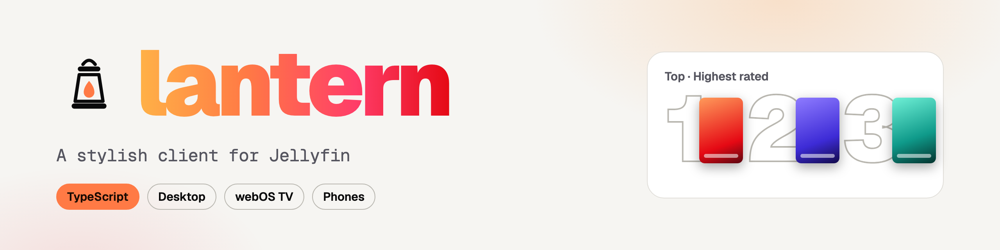
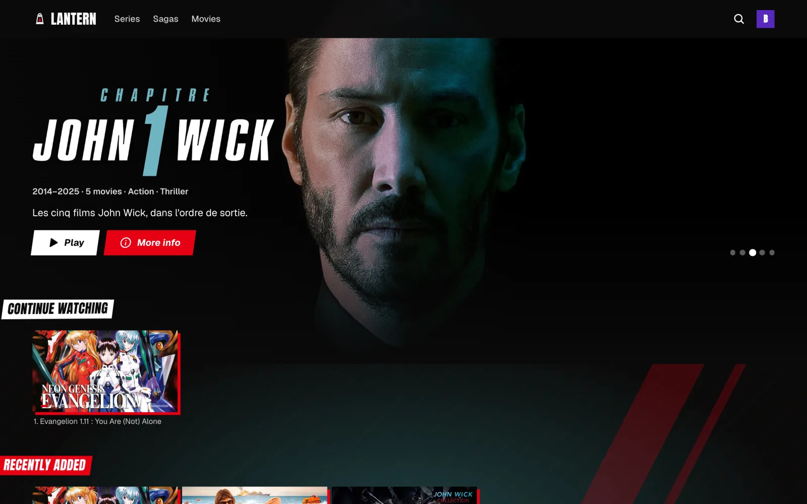
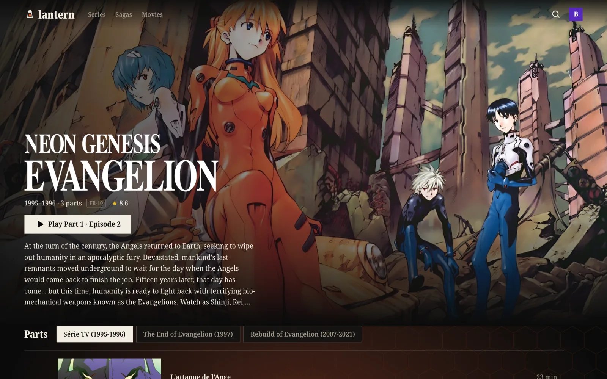
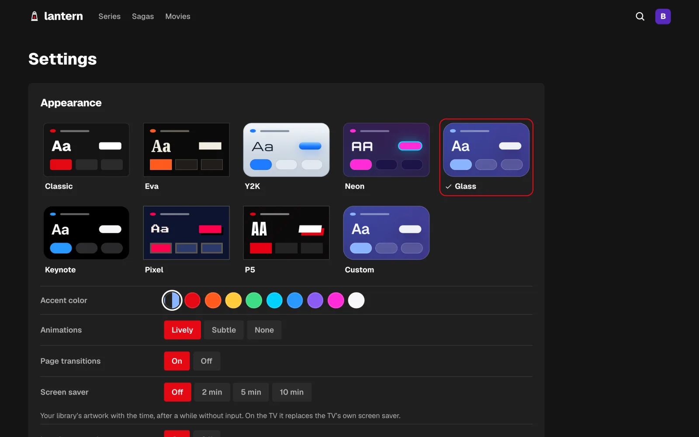

<picture>
  <source media="(prefers-color-scheme: dark)" srcset="docs/banner-dark.png">
  
</picture>

# Lantern

[](https://github.com/Bouliw/lantern/actions/workflows/ci.yml)

Lantern is a fast, stylish client for [Jellyfin](https://jellyfin.org). It is one small web app: it runs in
a desktop browser and installs as an app from Safari, works on phones, and ships as a packaged app for LG
webOS TVs, where every press of the remote answers instantly. Jellyfin stays the engine behind it; Lantern
only replaces the interface.



## What it does

- **A home page built around what you watch**: a rotating banner (fade, arrows, dots, logo, summary, Play and
  More info), then Continue watching, recently added titles, movies, series, sagas, a ranked Top of the best
  rated titles, genres and "Because you watched…" rows. Title pages end with "More like this".
- **Sagas, not piles of sequels**: movies that belong to a Jellyfin collection are grouped into one saga card,
  with its own page listing the films in release order.
- **Parts instead of seasons** when a show's seasons have their own names (a TV run, a film, a film series).
  Extras are shown like a season of their own on the movie page.
- **Its own player**: direct play when the device can, otherwise HLS through Jellyfin (remux first, transcode
  only when needed). Audio and subtitle choice, forced subtitles in the spoken language shown on their own,
  resume, next episode, skip intro and credits (media segments), scrubbing previews (trickplay) and chapters. After a long pause it shows what you are watching; during the
  credits the video steps aside for the next episode.
- **Recommendations computed on the device** from genres, directors, writers, cast, studios, tags, decade and
  title words (TF-IDF and cosine similarity), blended with the viewer's history and Jellyfin's own "similar"
  list.
- **Eight styles with their own feel**: Classic, Eva, Y2K, Neon, Glass, Keynote, Pixel and P5. A style sets the
  colors, typography and shapes, and also the motion: how a card is selected, page transitions, an animated
  backdrop, how titles appear, the mouse cursor, the seek bar, interface sounds and a generative background
  music in its mood. Colors, typography and shapes can be mixed into a custom style.
- **Motion that feels physical** on a computer: cards lift and tilt toward the cursor, buttons squash and
  bounce, rows slide in as you scroll and pages move with depth. The page takes on the colors of the artwork
  on screen, and a title you linger on turns into a short silent montage of its trickplay frames.
- **Built for each screen**: native trackpad scrolling and hover previews on a computer; instant,
  focus-following navigation on the TV, with an OLED-safe screen saver that replaces the TV's own while Lantern
  is open; a touch layout on phones.
- **Everything can be turned down**: animations, page transitions, sounds, music, ambient color and the screen
  saver each have a setting. Appearance can follow the profile across devices or stay on one device.
- **English and French**, following the device language or set by hand, including summaries (see below).
- **Sign in on the TV with a code**: Jellyfin Quick Connect, approved from Settings on any signed-in device.
- **Resilient playback**: if a device fails to decode what it claimed to support, the player retries through
  hls.js, then as a plain H.264 transcode.
- **No CDN, no tracking**: fonts are bundled, sounds and music are synthesized in the browser, artwork is
  preloaded and cached on the device.

<p>
  
  
</p>

## Requirements

- A Jellyfin server (10.9 or later).
- Node.js 20 or later to build.
- Optional: the Intro Skipper plugin (skip buttons) and trickplay images enabled in Jellyfin (scrubbing
  previews and live thumbnails).

## Build and run

```sh
npm install
npm run build        # outputs dist/
npm run serve        # serves dist/ on http://localhost:8097
```

The app talks to Jellyfin on the same host, port 8096, unless another server is chosen on the sign-in screen.

### macOS: start at login

```sh
npm run deploy:mac   # builds, copies the app to ~/Library/Application Support/Lantern, serves it at login
```

In Safari, open `http://localhost:8097` and choose **File › Add to Dock** to get a standalone app.

### LG webOS TV

**From a release**: download `app.lantern.tv_<version>_all.ipk` from the
[latest release](https://github.com/Bouliw/lantern/releases/latest) and install it on a TV in developer mode,
with `ares-install` or [webOS Dev Manager](https://github.com/webosbrew/dev-manager-desktop). On first launch,
Lantern asks for the address of your Jellyfin server. It needs webOS 22 or later.

**From source**: the TV must be in [developer mode](https://webostv.developer.lge.com/develop/getting-started/developer-mode-app)
and registered with the webOS CLI (`ares-setup-device`).

```sh
npm run tv -- --server http://<jellyfin-host>:8096 --device <ares-device-name>
```

This builds a package (`out/*.ipk`) with the server address inside, installs it and launches it.
`npm run tv -- --release` builds the generic package published in the releases instead, with the manifest used
by the webOS Homebrew Channel. The server address and device name can also
be stored in a git-ignored `lantern.config.json`:

```json
{ "server": "http://192.168.1.10:8096", "device": "tv" }
```

### Summaries in the interface language

Jellyfin keeps one summary per title, in the library's metadata language. To show summaries in the other
interface language too, run this on the server machine (administrator API key needed):

```sh
node scripts/localize-overviews.mjs --server http://localhost:8096 --token-file <api-key-file> \
  --out ~/Library/Application\ Support/Lantern/overviews.json --langs en,fr
```

It asks Jellyfin's own metadata providers for the missing languages, keeps what it already has (so it is cheap
to run on a schedule) and leaves locked, hand-written summaries alone. The macOS service serves the file to
every device, TVs included.

### Phones

Open `http://<computer>:8097` on the phone and add it to the home screen. For offline viewing, see
[docs/phones.md](docs/phones.md).

## How the library is read

| Lantern | Jellyfin |
| --- | --- |
| Movies | movies that are not in a collection |
| Sagas | collections (box sets) that contain movies |
| Series | TV shows |
| Parts | seasons whose names are not "Season N" |
| Extras | special features of a movie |

## Controls

| Action | Keyboard | TV remote |
| --- | --- | --- |
| Play / pause | Space or K | OK, Play/Pause |
| Seek ±10 s | ← / → | ← / → (presses add up, then jump) |
| Volume | ↑ / ↓ | TV volume |
| Full screen | F | — |
| Back | Esc | Back |

## Project layout

```
src/api        Jellyfin client, catalog cache, artwork URLs
src/home       home rows
src/reco       recommendation engine
src/player     player, device profile, subtitles
src/fx         motion, sounds and music, ambient color, transitions, live thumbnails, TV power
src/nav        TV remote navigation
src/pages      pages (home, library, details, search, settings, profiles)
src/themes     style definitions
src/styles     CSS (styles are split into palette, typography and shape layers)
scripts        static server, macOS service, webOS packaging, icons, cursors
webos          webOS app manifest and icons
```

## More tools by Bouliw

- [Roughcut](https://github.com/Bouliw/fcpxml-roughcut): Turns talking-head footage into a rough cut you finish in Final Cut Pro.
- [Vigie](https://github.com/Bouliw/vigie): Sigma detection on Windows, Linux and macOS logs, with a report mapped to MITRE ATT&CK.
- [Earshot](https://github.com/Bouliw/earshot): Live, on-device transcription of any app on your Mac, with speaker names.
- [doc-indexer-macos](https://github.com/Bouliw/doc-indexer-macos): On-device OCR for a folder of paperwork, ready for grep or an AI agent.
- [Boulito](https://github.com/Bouliw/boulito): A voice assistant that runs 100% on your Mac.
- [trackmend](https://github.com/Bouliw/trackmend): Repairs a macOS Music library full of local files.
- [Takeline](https://github.com/Bouliw/takeline): A teleprompter that follows your voice, entirely on your Mac.
- [mac-toolkit](https://github.com/Bouliw/mac-toolkit): Small tools I use every day on my Mac.

All projects: [bouliw.github.io](https://bouliw.github.io)

## License

MIT. Bundled fonts are under the SIL Open Font License, see [THIRD_PARTY_NOTICES.md](THIRD_PARTY_NOTICES.md).
